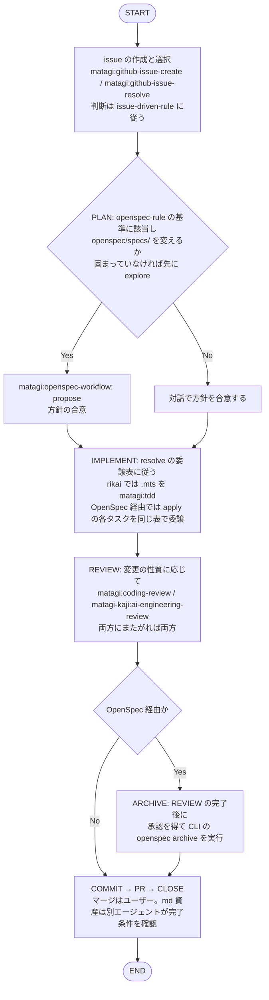

# Dev Rule

rikaiの開発ルール。概要は [README.md](README.md)、仕様は [openspec/specs/](openspec/specs/)、設計と未決事項は `openspec/changes/archive/*-rikai-skill-spec/design.md`（日付接頭辞つき。以下 `rikai-skill-spec` の `design.md`）を参照する。
個別のルールは `.claude/rules/` に置く。

## 前提

- Claude Codeで開発する。必須pluginは `matagi`、`matagi-kaji`、`yomiyasu`（日本語の推敲）、`genshijin`（応答文体の圧縮）（`.claude/settings.json` で有効化済み。初回はフォルダの信頼とpluginの導入の承認が要る）。
- `genshijin` と他のスキルの優先順位は `.claude/rules/genshijin-priority.md` に従う。必須なのは開発環境の話で、rikaiスキル自体はこれらのpluginに依存しない。
- スクリプト（`.mts`）の実行にNodeが必要。最小バージョンは `rikai-skill-spec` の `design.md`「スクリプトの実装方針」を参照する。
- `issue-driven-rule`・`openspec-rule` など、`matagi` と `matagi-kaji` のルールはプラグイン側の `shared-rules/` にあり、各スキルが参照する。このリポジトリでは複製せず、ルール名だけを挙げる。

## Branch Strategy

Trunk Based Developmentを採用する。短命の作業ブランチを切り、PRでmainに取り込む。
保護ブランチの扱いは、下のIssue Managementに従う。`matagi` のhookはClaude Codeセッション内の制約で、GitHub側のブランチ保護の代わりではない。

## Version Management

SemVerを採用する。運用（バージョンの所在など）は未決。`rikai-skill-spec` の `design.md` の Open Questions「リポジトリ」を参照する。

## Spec Management

Spec駆動開発を採用する。適用の判断基準は `openspec-rule` に従う。rikaiでは、このうち `openspec/specs/` の仕様を変える変更を対象とし、該当する変更は `matagi:openspec-workflow` で進める。
OpenSpec CLIが生成する `openspec-apply-change`・`openspec-archive-change`・`/opsx:apply`・`/opsx:archive` は、委譲とレビューゲートを通らないため、`.claude/settings.json` の `permissions.deny` でSkillツール経由の起動を禁止している。ワークフロー経由の起動も止まるため、ARCHIVEはREVIEWの完了後に、承認を得て `openspec archive` をCLIで実行する。
`openspec-sync-specs` と `/opsx:sync` はdenyしていない。`matagi` 側の扱い（openspec-ruleはレビューゲートの後、openspec-overviewはそのまま使う）が食い違うため、整理を待つ。`openspec update` で再生成したときは、denyの対象名が変わっていないか確認する。

## Issue Management

issue駆動開発を採用する。リポジトリに残る変更（コード・設定・ドキュメント）は、issue経由で行う。
ブランチ名、1 issue = 1 branch = 1 PR、保護ブランチの扱いは、下のスキルに従う。

- issueを発行：`matagi:github-issue-create`
- 課題解決：`matagi:github-issue-resolve`

## Skill Development

- スキルの新規作成は `matagi-kaji:create-skill`、レビューは `matagi-kaji:ai-engineering-review` を使う。どちらも `matagi:github-issue-resolve` の手順の中で呼ばれる。
- `matagi-kaji:create-skill` の既定の配置先（`plugins/matagi/skills/`）と、スキルに内包するルールの `rules/` への切り出しは、rikaiには当てはまらない。通常のチャットでも `SKILL.md` だけで完結させるため、`skills/rikai/SKILL.md` に全ルールを集約する（`rikai-skill-spec` の `design.md`「コアは `SKILL.md` だけで完結させる」「リポジトリの目標構成」）。

## Script Development

スクリプト（`.mts`）の開発はTDDで実装する（`matagi:tdd`）。テストはvitestを用い、リポジトリ直下の `__tests__/` に置く。スクリプトの方針は、`rikai-skill-spec` の `design.md`「スクリプトの実装方針」「リポジトリの目標構成」を参照する（`design.md` の `tests/` は `__tests__/` に読み替える）。型検査は `npm run typecheck`、lintは `npm run lint`（Biome）で行う。

## Writing

日本語の文章を書くとき、またはコードコメントを書くときは、先に `genshijin` の口調で書き、そのあとに `yomiyasu:yomiyasu` で校正する。

- 対象は、リポジトリに残る文章（README、`openspec/`、スキル、ルール、コードコメントなど）。`genshijin` は通常レベルで使う。
- 口調など、両者の指示が食い違う点は、あとの `yomiyasu` の校正を優先する。意味・条件・数値は変えない。
- issueとPRの本文は、`genshijin` の口調にはせず、通常の日本語で書いて `yomiyasu` で校正する。
- コミットメッセージは両方の対象外。`matagi:commit-message-simple` に従う。
- 圧縮の範囲と他のスキルとの優先順位は、`.claude/rules/genshijin-priority.md` に従う。

## Dev Workflow

順序と委譲先は `matagi:github-issue-resolve` が定める。図はその要約で、rikai固有の点は、`.mts` を `matagi:tdd` で実装することと、OpenSpecの対象を `openspec/specs/` の変更に絞ることだけ。

- issueを作るか、同じやり取りで続行するかの判断は、`issue-driven-rule` に従う。
- md資産と設定ファイルの編集には委譲先が無く、`matagi:github-issue-resolve` が直接編集する（OpenSpecのapplyでも同じ）。
- REVIEWはarchiveの前に、実装者と別のエージェントが行う。
- 委譲表の全体、レビューの対象ごとの委譲先、CLOSEの手順は `matagi:github-issue-resolve` を参照する。
