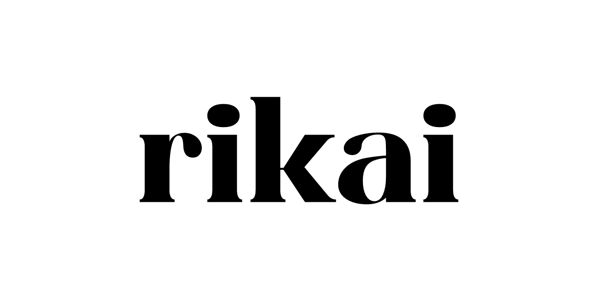
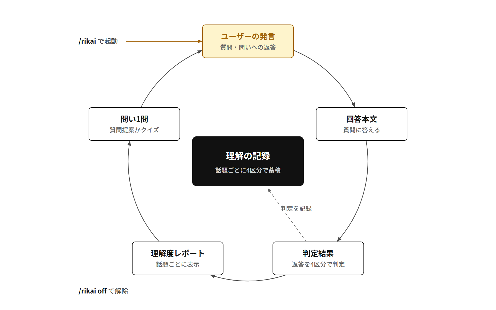

# rikai (りかい)



[](./LICENSE)
[](https://github.com/kokuto821/rikai/releases)

[English](README.en.md)

## これは何？

rikaiはAIの回答のたびにユーザーの理解を確かめて、物事の理解を深めるためのAgentSkillです。

向いている場面は次のとおりです。

- AIにコードやドキュメントを作ってもらい、中身を理解してから先へ進みたいとき
- 本やインターネットで調べた概念のうち分からなかったところや、自分の理解が合っているかを、AIに尋ねて確かめたいとき

## 導入

現時点では、Claude Codeのpluginと、Web版のClaudeのスキル登録（ZIP）に対応しています。ほかの環境で使う場合は、ZIPに入っている `SKILL.md` をその環境のスキルの置き場所に置いてください（動作は確認していません）。

### Claude Code

Claude Codeでは、pluginとして導入します。Claude Codeの入力欄で、次のコマンドを順に実行します。

```text
/plugin marketplace add kokuto821/rikai
/plugin install rikai@rikai
```

### ZIPファイルからの登録

以下のリンクから、登録専用のZIPファイルをダウンロードしてください。

- [rikai.zip（最新版ダウンロード）](https://github.com/kokuto821/rikai/releases/latest/download/rikai.zip)

ダウンロードした `rikai.zip` を解凍せず、Claudeのスキル登録画面にそのままアップロードしてください。

※ GitHubの「Download ZIP」で取得したZIPは、余分なファイルを含むため登録できない場合があります。

## 背景と課題

生成AIは日常的な道具となり、コードやドキュメントを、中身を理解していなくても作れるようになりました。AIが作ったコードやドキュメントを読んだり、説明を聞いたりしただけでは、本当に理解しているかは自分では分かりません。人に説明してもらうときや、本を読むときも同じです。理解したつもりのまま、次へ進んでしまいます。

AIエージェントの場合、原因の一つは、依頼されたタスクの実行に忠実なことです。ユーザーが理解していなくても、AIは立ち止まらず、次のタスクに進めようとします。

## 本スキルのアプローチ

ユーザー自身の言葉から本当に理解しているかチェックすることに重きを置いています。AIはタスクの実行に忠実なので、理解を確かめる手順を渡しておけば、回答のたびにユーザーの理解を確かめます。

AIの回答ごとに、次の流れを繰り返します。

1. 問いを1問出す（質問提案かクイズ）
2. 返答から、理解している箇所と理解していない箇所を判定する
3. 理解度レポートを更新する



## 使用例

AIに送信ボタンの色の変更を頼んだ場面です。AIはボタンの色を決めている共通の変数 `--color-primary` を書き換えました。この変数は他のボタンやリンクでも使われています。

### rikaiを使わない場合

> **ユーザー**\
> 送信ボタンを青にして。
>
> **AI**\
> `--color-primary` を青に変更しました。次はマージしますか？
>
> **ユーザー**\
> お願い。

他のボタンやリンクの色も変わることに気づかないまま、変更がマージされます。

### rikaiを使う場合

Claude Codeで、rikaiを起動したあとの場面です。説明のため、1回目の回答に付く理解度レポートを省略し、一部を整えています。

> **ユーザー**\
> 送信ボタンを青にして。
>
> **AI**\
> `--color-primary` を青に変更しました。
>
> **問い**: この変更で色が変わるのはどこですか。理由も答えてください。\
> A. 送信ボタンだけ\
> B. `--color-primary` を使っている全ての箇所\
> C. 全てのボタン
>
> **ユーザー**\
> A。送信ボタンを青にしてと頼んだから。
>
> **AI**\
> 判定: 理解できてない
>
> 正解はBです。変更したのは送信ボタン専用の色ではなく、共通の変数です。同じ変数を使う他のボタンやリンクの色も変わります。

マージの前に、想定と実際の変更のズレが分かります。結果はレポートに残ります。

```markdown
# 理解度レポート: 送信ボタンの色の変更
回答番号: 1
概要: 送信ボタンの色を変更したときの影響範囲の理解

## 理解した箇所
- なし

## 一部理解した箇所
- なし

## 理解できてない箇所
- `--color-primary` を変更すると、同じ変数を使う全ての箇所の色が変わること

## AIから解説されたがユーザーからの返答がない箇所
- なし
```

### 次の問い

レポートのあとに、次の問いが1問だけ続きます。問いはクイズか質問提案のどちらかです。今回の場面なら、たとえば次のようになります。

#### クイズ

理解を確かめる問題に答えます。上の例のような選択式のほか、記述式もあります。

> `--color-primary` を変えると、なぜ送信ボタン以外の色も変わるのですか。

#### 質問提案

次にAIへ聞くとよい質問を、AIが提案します。

> 「`--color-primary` を使っている箇所はどこ？」と聞いてみましょう。

自分の言葉での言い換えを促すこともあります。AIは答えを埋めず、ユーザーが考えて言い換えます。

> 「`--color-primary` を変えると△△ってこと？」の形で、△△を自分の言葉で埋めてみましょう。

## 詳しい動作

### 起動と終了

`/rikai` か「rikaiを始めて」で起動し、`/rikai off` か「rikai終了」で解除します。「理解度チェックしながら説明して」「もうクイズはいらない」のように、名前を出さずに頼んでも切り替わります。

### 問いの出し方

質問提案から始めて、質問提案とクイズを交互に出します。どの環境でも同じです。

### 判定

返答がAIの解釈と一致するかで「理解した／一部理解した／理解できてない／返答がない」の4つに分けます。理解が足りない箇所を見つけるためのもので、点数でも、AIの回答の正しさの保証でもありません。

### 理解度レポート

話題ごとに、上の4つの区分で箇所を記録します。既定はチャット内に出します。ファイルに保存したいときは、そう伝えてください。保存先を指定しなければ `.rikai/<topic>-rikai-report.md` に保存します。保存中は、レポートをチャットに出しません。ファイルを書けない環境（Web版のClaudeなど）では、保存できないことを伝えて、チャット内で続けます。

### 環境

Claude Codeではpluginとして、Web版のClaudeではZIPで登録して使います。どちらでも同じように動きます。レポートのファイル保存は、ファイルを書ける環境（Claude Codeなど）で使えます。

### 言語

出力はユーザーの発言の言語に合わせます。英語で話しかければ、問いもレポートも英語で出ます。

## 他のスキルとの併用

類似のスキル（理解を確かめるスキルなど）や、文体を変えるスキルと併用すると、指示が食い違う場合があります。たとえば、判定結果・理解度レポート・問いが、併用するスキルの文体で圧縮されることがあります。出力が乱れる場合は、併用するスキルを無効にして使ってください。

## 入力欄のサジェスト

Claude Codeは入力欄に次の発言の予測を薄い文字で出すことがあります（プロンプトサジェスト）。クイズの直後にその答えが出てしまうことがあります。サジェストはClaude Code本体の機能で、スキルからは抑えられません。答えが見えて困るときは、利用者の設定で無効にしてください。

- `/config` の Prompt suggestions をオフにします
- または `settings.json` に `"promptSuggestionEnabled": false` を書きます
- または環境変数 `CLAUDE_CODE_ENABLE_PROMPT_SUGGESTION=false` を設定します（`/config` と `settings.json` のどちらよりも優先されます）

## ライセンス

[MIT License](LICENSE)
