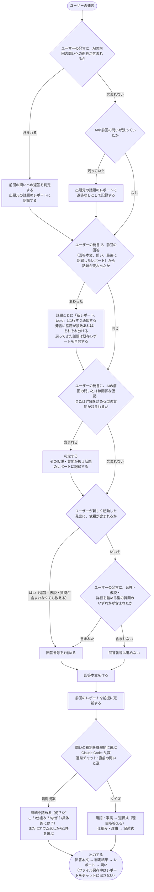

## MODIFIED Requirements

### Requirement: 1ターンを一定の流れで処理する
rikai は、モード有効中の1ターンを、次の流れで処理しなければならない（SHALL）。この流れは他の要件の内容を図にしたもので、新しい決定は加えない。各ステップの確度（確定・既定）は、参照先の要件に従う。

判定は rikai-understanding-judgement、レポートの更新と話題の分割は rikai-understanding-report、問いの種類の選択と回答番号の数え方は rikai-question-selection、出力順は「毎回の出力を一定の順に並べる」に従う。未回答の問いは、前回の問い1つだけである（毎回の問いは1問のため）。

#### Scenario: 返答を含む発言
- **WHEN** ユーザーの発言に、前回の問いへの返答（クイズの回答、提案された質問、言い換え）が含まれる
- **THEN** 判定して出題元の話題のレポートに記録してから、話題の変化の確認に進む

#### Scenario: 返答を含まず、前回の問いが残っていた場合
- **WHEN** ユーザーの発言に前回の問いへの返答が含まれず、前回の問いが残っていた
- **THEN** 出題元の話題のレポートに返答なしとして記録してから、話題の変化の確認に進む。発言が別の話題への仮説を含んでいても、記録は変わらない

#### Scenario: 返答を含まず、前回の問いも残っていない場合
- **WHEN** ユーザーの発言に前回の問いへの返答が含まれず、前回の問いも残っていない
- **THEN** 返答の判定も記録もせず、話題の変化の確認に進む

#### Scenario: 話題が変わった発言
- **WHEN** ユーザーの発言で、話題が変わったとAIが判断する
- **THEN** 「新レポート: topic」と1行で通知してレポートを分けてから、AIの前回の問いとは無関係な仮説や質問が含まれるかの確認に進む。戻ってきた話題は既存レポートを再開する

#### Scenario: 話題が変わっていない発言
- **WHEN** ユーザーの発言で、話題が変わっていないとAIが判断する
- **THEN** レポートを分けずに、AIの前回の問いとは無関係な仮説や質問が含まれるかの確認に進む

#### Scenario: 問いとは無関係な仮説を含む発言
- **WHEN** ユーザーの発言に、AIの前回の問いとは無関係な仮説、または詳細を詰める型の質問が含まれる
- **THEN** 判定して、その仮説・質問が扱う話題のレポートに記録してから、回答番号の確認に進む。新しい話題への仮説なら、分けた新しい話題のレポートに記録する。発言に複数の話題への仮説があれば、それぞれの話題のレポートに記録する

#### Scenario: 返答も仮説も質問も含まない発言
- **WHEN** 起動後の2回目以降で、ユーザーの発言に、前回の問いへの返答も、仮説も、詳細を詰める型の質問も含まれない
- **THEN** 回答番号を進めずに、回答本文の作成に進む

#### Scenario: 回答番号を進める発言
- **WHEN** ユーザーの発言に、返答、仮説、詳細を詰める型の質問のいずれかが含まれる
- **THEN** 回答番号を1進めてから、回答本文の作成に進む
