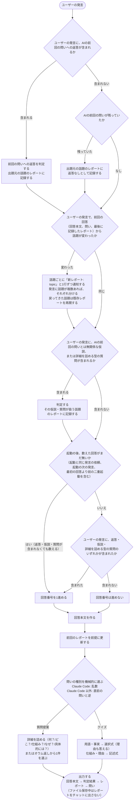

## MODIFIED Requirements

### Requirement: 全ての回答に問いとレポートを付ける
モード有効中、rikai は全ての回答に問いと理解度レポートを付けなければならない（SHALL）。説明を含まない回答にも付け、その場合は作業内容（何を・なぜ）を素材にする。回答番号を進めないターンにも、同じく付ける。ただし、起動を知らせる応答（問いもレポートも付けない）と、終了の応答（最終レポートのみ付け、問いは付けない。数えた回答が無いまま終了したときは、最終レポートも付けない）を除く。ファイルに保存している間は、レポートをチャットに出さない（rikai-understanding-report に従う）。（確定）

#### Scenario: 説明を含まない回答
- **WHEN** モード有効中に、説明を含まない回答を返す
- **THEN** 作業内容（何を・なぜ）を素材に、問いと理解度レポートを付ける

#### Scenario: 回答番号を進めないターン
- **WHEN** モード有効中に、前回の問いへの返答も、仮説も、詳細を詰める型の質問も含まない発言へ回答する
- **THEN** 回答番号は進めず、問いと理解度レポートを付ける

#### Scenario: 起動の応答
- **WHEN** rikai を起動した直後の応答を返す
- **THEN** 問いも理解度レポートも付けない

#### Scenario: 終了の応答
- **WHEN** 数えた回答がある状態で、終了指示への応答を返す
- **THEN** 全話題の最終の理解度レポートを付け、問いは付けない。ファイルに保存している場合は、最終レポートの代わりに、保存した全話題のファイルのパスを、1行にまとめて並べる

### Requirement: セッション持続モードで動作する
rikai は、一度起動されると以後の全回答に問いと理解度レポートを付け、終了語で解除されるまで有効でなければならない（SHALL）。（確定）モードが有効かどうかは、会話の文脈で決まる。

終了指示への応答は、判定結果（前回の問いへの返答があったときのみ）、全話題の最終の理解度レポート（話題ごとに順に1回だけ）の順にする。回答本文と問いは付けない。ファイルに保存している場合は、最終の理解度レポートの代わりに、保存した全話題のレポートのファイルのパスを、1行にまとめて並べる（rikai-understanding-report に従う）。終了のターンでも、前回の問いへの返答の判定と、返答なしの記録を行ってから出す。新しい話題への仮説があれば、その話題のレポートを作って記録する。終了時に、話題とレポートの状態は破棄し、再び起動しても引き継がない。（確定）

起動の後、数えた回答が無いまま終了したとき（起動の直後に終了したときなど）は、判定結果も最終の理解度レポートも、ファイルのパスも出さず、終了した旨の1行だけを出す。終了の発言に仮説があっても、記録しない。記録しても終了時に破棄され、回答番号の無いレポートを出すことになるため。（確定）

会話圧縮や `/clear` など、外部要因でモードが失われることは許容する。失われた場合は、再度 `/rikai` で起動する。復元の手段は設けない。（確定）

#### Scenario: 起動後の回答
- **WHEN** ユーザーが rikai を一度起動し、続けて発言する
- **THEN** 以後の全回答に問いと理解度レポートが付く

#### Scenario: 終了語による解除
- **WHEN** 数えた回答がある状態で、ユーザーが終了語を送る
- **THEN** 終了指示への応答に全話題の最終の理解度レポートを付け（問いは付けない）、それより後の回答には問いも理解度レポートも付けない。ファイルに保存している場合は、最終レポートの代わりに、保存した全話題のファイルのパスを、1行にまとめて並べる

#### Scenario: 終了のターンに前回の問いが残っていた場合
- **WHEN** 前回の問いが残っている状態で、ユーザーが終了語を送る
- **THEN** 前回の問いへの返答があれば判定し、無ければ返答なしとして記録してから、最終の理解度レポートを出す

#### Scenario: 数えた回答が無いまま終了する
- **WHEN** `/rikai` だけを送り、次の発言で `/rikai off` を送る
- **THEN** 終了した旨の1行だけを出し、判定結果も最終の理解度レポートもファイルのパスも出さない

#### Scenario: 外部要因によるリセット
- **WHEN** 会話圧縮や `/clear` により、モードが有効だった記憶が失われる
- **THEN** モードは解除されたものとして扱い、ユーザーが再度 `/rikai` で起動する

### Requirement: 起動の応答は有効化の通知と形式の提案だけにする
rikai は、起動を知らせる応答に、モードが有効になった旨の1行と、レポート形式の提案（ファイル保存が可能な環境のみ）だけを書かなければならない（SHALL）。素材が無いため、理解度レポートも問いも付けない。この応答は回答番号に数えない。同じ発言に依頼が含まれる場合は、この応答のあと、その依頼を通常の回答として処理する。起動後の最初の回答は、起動と同じ発言の依頼への回答でも、次の発言への回答でも、回答番号 1 として数える（数え方は rikai-question-selection に従う）。（確定）

#### Scenario: 起動の応答の内容
- **WHEN** rikai を起動した直後に応答する
- **THEN** 有効になった旨の1行（とファイル保存が可能な環境ではレポート形式の提案）だけを出し、回答番号には数えない

#### Scenario: 起動の発言に依頼が含まれる
- **WHEN** 「rikaiを始めて。Xを説明して」のように、起動の発言に依頼が含まれる
- **THEN** 起動の1行のあと、Xへの回答を通常の回答（回答番号 1、判定結果・レポート・問いの順）として出す

#### Scenario: 起動の次の発言が依頼だけ
- **WHEN** `/rikai` だけを送り、次の発言で「Xを説明して」と依頼だけを送る
- **THEN** Xへの回答を通常の回答として出し、回答番号は 1 になる

### Requirement: 1ターンを一定の流れで処理する
rikai は、モード有効中の1ターンを、次の流れで処理しなければならない（SHALL）。この流れは他の要件の内容を図にしたもので、新しい決定は加えない。各ステップの確度（確定・既定）は、参照先の要件に従う。

判定は rikai-understanding-judgement、レポートの更新と話題の分割は rikai-understanding-report、問いの種類の選択と回答番号の数え方は rikai-question-selection、出力順は「毎回の出力を一定の順に並べる」に従う。未回答の問いは、前回の問い1つだけである（毎回の問いは1問のため）。

#### Scenario: 返答を含む発言
- **WHEN** ユーザーの発言に、前回の問いへの返答（クイズの回答、提案された質問、言い換え）が含まれる
- **THEN** 判定して出題元の話題のレポートに記録してから、話題の変化の確認に進む

#### Scenario: 返答を含まず、前回の問いが残っていた場合
- **WHEN** ユーザーの発言に前回の問いへの返答が含まれず、前回の問いが残っていた
- **THEN** 出題元の話題のレポートに返答なしとして記録してから、話題の変化の確認に進む。発言が別の話題への仮説を含んでいても、記録は変わらない

#### Scenario: 返答を含まず、前回の問いも残っていない場合
- **WHEN** ユーザーの発言に前回の問いへの返答が含まれず、前回の問いも残っていない
- **THEN** 返答の判定も記録もせず、話題の変化の確認に進む

#### Scenario: 話題が変わった発言
- **WHEN** ユーザーの発言で、話題が変わったとAIが判断する
- **THEN** 「新レポート: topic」と1行で通知してレポートを分けてから、AIの前回の問いとは無関係な仮説や質問が含まれるかの確認に進む。戻ってきた話題は既存レポートを再開する

#### Scenario: 話題が変わっていない発言
- **WHEN** ユーザーの発言で、話題が変わっていないとAIが判断する
- **THEN** レポートを分けずに、AIの前回の問いとは無関係な仮説や質問が含まれるかの確認に進む

#### Scenario: 問いとは無関係な仮説を含む発言
- **WHEN** ユーザーの発言に、AIの前回の問いとは無関係な仮説、または詳細を詰める型の質問が含まれる
- **THEN** 判定して、その仮説・質問が扱う話題のレポートに記録してから、回答番号の確認に進む。新しい話題への仮説なら、分けた新しい話題のレポートに記録する。発言に複数の話題への仮説があれば、それぞれの話題のレポートに記録する

#### Scenario: 返答も仮説も質問も含まない発言
- **WHEN** 起動後の2回目以降で、ユーザーの発言に、前回の問いへの返答も、仮説も、詳細を詰める型の質問も含まれない
- **THEN** 回答番号を進めずに、回答本文の作成に進む

#### Scenario: 回答番号を進める発言
- **WHEN** ユーザーの発言に、返答、仮説、詳細を詰める型の質問のいずれかが含まれる
- **THEN** 回答番号を1進めてから、回答本文の作成に進む
