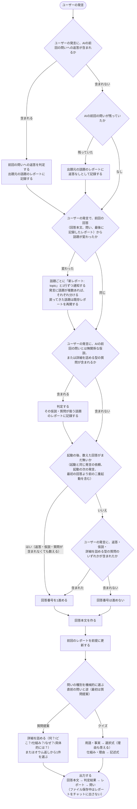

## RENAMED Requirements

- FROM: `### Requirement: 起動の応答は有効化の通知と形式の提案だけにする`
- TO: `### Requirement: 起動の応答は有効化の通知と形式の案内だけにする`

## MODIFIED Requirements

### Requirement: 1ターンを一定の流れで処理する
rikai は、モード有効中の1ターンを、次の流れで処理しなければならない（SHALL）。この流れは他の要件の内容を図にしたもので、新しい決定は加えない。各ステップの確度（確定・既定）は、参照先の要件に従う。

判定は rikai-understanding-judgement、レポートの更新と話題の分割は rikai-understanding-report、問いの種類の選択と回答番号の数え方は rikai-question-selection、出力順は「毎回の出力を一定の順に並べる」に従う。未回答の問いは、前回の問い1つだけである（毎回の問いは1問のため）。

#### Scenario: 返答を含む発言
- **WHEN** ユーザーの発言に、前回の問いへの返答（クイズの回答、提案された質問、言い換え）が含まれる
- **THEN** 判定して出題元の話題のレポートに記録してから、話題の変化の確認に進む

#### Scenario: 返答を含まず、前回の問いが残っていた場合
- **WHEN** ユーザーの発言に前回の問いへの返答が含まれず、前回の問いが残っていた
- **THEN** 出題元の話題のレポートに返答なしとして記録してから、話題の変化の確認に進む。発言が別の話題への仮説を含んでいても、記録は変わらない

#### Scenario: 返答を含まず、前回の問いも残っていない場合
- **WHEN** ユーザーの発言に前回の問いへの返答が含まれず、前回の問いも残っていない
- **THEN** 返答の判定も記録もせず、話題の変化の確認に進む

#### Scenario: 話題が変わった発言
- **WHEN** ユーザーの発言で、話題が変わったとAIが判断する
- **THEN** 「新レポート: topic」と1行で通知してレポートを分けてから、AIの前回の問いとは無関係な仮説や質問が含まれるかの確認に進む。戻ってきた話題は既存レポートを再開する

#### Scenario: 話題が変わっていない発言
- **WHEN** ユーザーの発言で、話題が変わっていないとAIが判断する
- **THEN** レポートを分けずに、AIの前回の問いとは無関係な仮説や質問が含まれるかの確認に進む

#### Scenario: 問いとは無関係な仮説を含む発言
- **WHEN** ユーザーの発言に、AIの前回の問いとは無関係な仮説、または詳細を詰める型の質問が含まれる
- **THEN** 判定して、その仮説・質問が扱う話題のレポートに記録してから、回答番号の確認に進む。新しい話題への仮説なら、分けた新しい話題のレポートに記録する。発言に複数の話題への仮説があれば、それぞれの話題のレポートに記録する

#### Scenario: 返答も仮説も質問も含まない発言
- **WHEN** 起動後の2回目以降で、ユーザーの発言に、前回の問いへの返答も、仮説も、詳細を詰める型の質問も含まれない
- **THEN** 回答番号を進めずに、回答本文の作成に進む

#### Scenario: 回答番号を進める発言
- **WHEN** ユーザーの発言に、返答、仮説、詳細を詰める型の質問のいずれかが含まれる
- **THEN** 回答番号を1進めてから、回答本文の作成に進む

### Requirement: 起動の応答は有効化の通知と形式の案内だけにする
rikai は、起動を知らせる応答に、モードが有効になった旨の1行と、レポート形式の案内（「起動時にレポート形式を一度だけ案内する」の内容。全環境）だけを書かなければならない（SHALL）。素材が無いため、理解度レポートも問いも付けない。この応答は回答番号に数えない。同じ発言に依頼が含まれる場合は、この応答のあと、その依頼を通常の回答として処理する。起動後の最初の回答は、起動と同じ発言の依頼への回答でも、次の発言への回答でも、回答番号 1 として数える（数え方は rikai-question-selection に従う）。（確定）

#### Scenario: 起動の応答の内容
- **WHEN** rikai を起動した直後に応答する
- **THEN** 有効になった旨の1行と、レポート形式の案内だけを出し、回答番号には数えない

#### Scenario: 起動の発言に依頼が含まれる
- **WHEN** 「rikaiを始めて。Xを説明して」のように、起動の発言に依頼が含まれる
- **THEN** 起動の1行のあと、Xへの回答を通常の回答（回答番号 1、判定結果・レポート・問いの順）として出す

#### Scenario: 起動の次の発言が依頼だけ
- **WHEN** `/rikai` だけを送り、次の発言で「Xを説明して」と依頼だけを送る
- **THEN** Xへの回答を通常の回答として出し、回答番号は 1 になる

### Requirement: 毎回の出力を一定の順に並べる
rikai は、モード有効中の毎回の出力を、次の順に並べなければならない（SHALL）。

1. 回答本文
2. 前回の問いに対するユーザーの返答があれば、その判定結果（採点・正解の提示）
3. 理解度レポート（Markdown コードブロック）。ファイルに保存している間は、チャットに出さない
4. 問い1問（最後尾の専用セクション）

問いを最後に置くのは、ユーザーが次の発言を書く直前に目に入る位置にするため。（確定）項目 1〜3 の並びは既定。

順序は崩さず、中身が無い要素だけを省く。（確定）

- 返答のみのターン（新しい依頼が無く、回答本文が空になる）: 回答本文は作らず、判定結果、理解度レポート、問いの順にする。判定結果に、正解や補足の解説を含める。問いの素材は、直前までの説明と判定結果にする。
- 詳細を詰める型の質問（何？／どこ？／仕組み？／なぜ？／具体的には？）で尋ねられたターン: ユーザーの質問への答えが回答本文になる。判定は「理解できてない」として記録する。採点と正解の提示は省き、判定結果の位置には「『○○』を理解できていない箇所として記録した」と1行だけ書く。
- 回答番号を進めないターン（前回の問いへの返答も、仮説も、詳細を詰める型の質問も含まない発言への回答）: 判定結果は無いので省き、回答本文、理解度レポート、問いの順にする。（確定）理解度レポートの回答番号は、前回のまま変えない。前回の問いが残っていれば、返答なしとして通知せずに記録し、レポートの変化で気づかせる。
- 付随の通知（「新レポート: <topic>」の通知、`.rikai/.gitignore` を作った通知、レポートの書き込み失敗の1行、保存できない環境で保存を頼まれたときの1行）は、回答本文の直前に、1つにつき1行で置く。本文が無いターンでは先頭に置く。レポート形式の案内は、起動の応答の扱いに従う。（既定。暫定）
- 理解度レポートとして出すのは、そのターンの話題のレポートと、判定や返答なしを記録した他の話題のレポートとする。変化が無いターンでも、そのターンの話題のレポートは出す。ただし、終了の応答では全話題のレポートを出す。ファイルに保存している間は、チャットには出さない。（確定）

問いセクションの見出し名は未決である。

#### Scenario: 前回の問いへの返答がある場合の出力
- **WHEN** ユーザーが前回の問いに返答した後、AIが回答する
- **THEN** 回答本文、判定結果、理解度レポート、問いの順に出力し、問いが最後尾の専用セクションに置かれる

#### Scenario: 返答のみのターン
- **WHEN** ユーザーが前回の問いに返答しただけで、新しい依頼が無い
- **THEN** 回答本文を省き、判定結果（正解や補足の解説を含む）、理解度レポート、問いの順に出力する

#### Scenario: 詳細を詰める型の質問をされた場合
- **WHEN** ユーザーが質問提案を受けて「○○は何？」「○○ってどこ？」「どういう仕組み？」「なぜ○○？」「具体的には？」のいずれかで尋ねる
- **THEN** 質問への答えを回答本文とし、判定結果の位置に「理解できてない箇所として記録した」旨を1行だけ書き、採点と正解の提示は省く

#### Scenario: 回答番号を進めないターンの出力
- **WHEN** ユーザーが前回の問いに答えず、仮説も詳細を詰める型の質問も含まない依頼をする
- **THEN** 判定結果を省き、回答本文、理解度レポート、問いの順に出力する。レポートの回答番号は前回のままで、前回の問いの「返答なし」だけが反映される

#### Scenario: 付随の通知
- **WHEN** 話題が変わって「新レポート: <topic>」を通知する、または `.rikai/.gitignore` を作った通知を出す
- **THEN** 回答本文の直前に、通知1つにつき1行で置く

#### Scenario: 保存できない環境で保存を頼まれたターンの出力
- **WHEN** ファイルを書けない環境で、ユーザーが保存を頼む
- **THEN** 保存できない旨の1行を回答本文の直前に置き、理解度レポートはチャットに出す

#### Scenario: 複数の話題があるときのレポートの出力
- **WHEN** 話題が複数に分かれているとき、話題Aで回答し、話題Bの判定は記録していない
- **THEN** 話題Aのレポートだけを出す。話題Bについての仮説の判定を記録した場合は、話題Bのレポートも出す

#### Scenario: ファイル保存中の出力
- **WHEN** ファイルへの保存を選んだ状態で、AIが回答する
- **THEN** 回答本文、判定結果（あれば）、問いの順に出力し、理解度レポートはチャットに出さない

## REMOVED Requirements

### Requirement: 起動時にレポート形式を一度だけ提案する
**Reason**: 起動時の提案を環境で分けず、全環境で保存を頼めることだけを案内するため（#46）。「ファイル保存が可能な環境」のシナリオを、要件ごと置き換える。
**Migration**: 「起動時にレポート形式を一度だけ案内する」に移す。

## ADDED Requirements

### Requirement: 起動時にレポート形式を一度だけ案内する
rikai は、起動時に、レポートはチャット内に出すこと、ファイルに保存したいときは伝えてほしいことを、一度だけ伝えなければならない（SHALL）。保存先のパスは示さない。環境を問わず同じ内容にする。返答を待たず、チャット内表示で進めなければならない（SHALL）。（確定。claude.ai のチャットなどでは、ファイルを保存できる環境かを見分けられず、環境で案内を分けると、使えない保存先を示すことがあるため）保存を頼まれたときの扱いは rikai-understanding-report に従う。

#### Scenario: 起動時の案内
- **WHEN** rikai を起動する
- **THEN** レポートはチャット内に出すこと、ファイルに保存したいときは伝えてほしいことを一度だけ伝え、保存先のパスは示さない。返答を待たずに進める

#### Scenario: claude.ai のチャットでの起動
- **WHEN** claude.ai のチャットにスキルを登録した環境で rikai を起動する
- **THEN** Claude Code と同じ案内を出し、`.rikai/` などの保存先のパスは示さない

#### Scenario: 案内に無応答
- **WHEN** 起動時の案内にユーザーが応答しない
- **THEN** チャット内表示で進める
