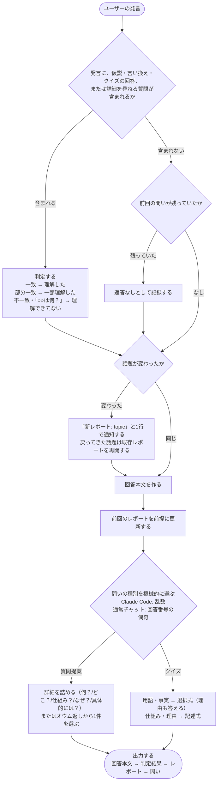

# rikai-session-mode Specification

## Purpose
AIの回答ごとにユーザーの理解を確かめ、理解を促進するため、rikai をセッション持続モードで起動・終了し、毎回の出力に判定結果・理解度レポート・問いを一定の順序で付ける。
## Requirements
### Requirement: 全ての回答に問いとレポートを付ける
モード有効中、rikai は全ての回答に問いと理解度レポートを付けなければならない（SHALL）。説明を含まない回答にも付け、その場合は作業内容（何を・なぜ）を素材にする。（確定）

#### Scenario: 説明を含まない回答
- **WHEN** モード有効中に、説明を含まない回答を返す
- **THEN** 作業内容（何を・なぜ）を素材に、問いと理解度レポートを付ける

### Requirement: セッション持続モードで動作する
rikai は、一度起動されると以後の全回答に問いと理解度レポートを付け、終了語で解除されるまで有効でなければならない（SHALL）。（確定）終了指示への応答に最終レポートを付けるかは未決である。

#### Scenario: 起動後の回答
- **WHEN** ユーザーが rikai を一度起動し、続けて発言する
- **THEN** 以後の全回答に問いと理解度レポートが付く

#### Scenario: 終了語による解除
- **WHEN** ユーザーが終了語を送る
- **THEN** 終了指示より後の回答には問いも理解度レポートも付けない。終了指示への応答の扱いは未決である

### Requirement: 起動と終了の指示を受け付ける
rikai は、起動を `/rikai`、終了を `/rikai off` で受け付けなければならない（SHALL）。通常チャットでは、自然言語（「rikaiを始めて」「rikai終了」）でも切り替えられなければならない（SHALL）。（既定）

コマンド名は、プラグインの名前空間で変わる可能性がある。（要確認）

#### Scenario: コマンドによる起動
- **WHEN** ユーザーが `/rikai` を送る
- **THEN** モードが有効になる

#### Scenario: コマンドによる終了
- **WHEN** モード有効中にユーザーが `/rikai off` を送る
- **THEN** モードが解除される

#### Scenario: 通常チャットでの自然言語による切り替え
- **WHEN** 通常チャットでユーザーが「rikaiを始めて」または「rikai終了」と送る
- **THEN** モードが有効または解除される

### Requirement: 起動時にレポート形式を一度だけ提案する
ファイル保存が可能な環境では、rikai は起動時にレポート形式を一度だけ提案しなければならない（SHALL）。返答を待たず、無応答ならチャット内表示で進めなければならない（SHALL）。（確定）

#### Scenario: ファイル保存が可能な環境での起動
- **WHEN** ファイル保存が可能な環境で rikai を起動する
- **THEN** レポート形式を一度だけ提案し、返答を待たずに進める

#### Scenario: 形式の提案に無応答
- **WHEN** レポート形式の提案にユーザーが応答しない
- **THEN** チャット内表示で進める

### Requirement: 毎回の出力を一定の順に並べる
rikai は、モード有効中の毎回の出力を、次の順に並べなければならない（SHALL）。

1. 回答本文
2. 前回の問いに対するユーザーの返答があれば、その判定結果（採点・正解の提示）
3. 理解度レポート（Markdown コードブロック）
4. 問い1問（最後尾の専用セクション）

問いを最後に置くのは、ユーザーが次の発言を書く直前に目に入る位置にするため。（確定）項目 1〜3 の並びは既定。返答のみのターンなど、この順では定まらないケースは未決である。

#### Scenario: 前回の問いへの返答がある場合の出力
- **WHEN** ユーザーが前回の問いに返答した後、AIが回答する
- **THEN** 回答本文、判定結果、理解度レポート、問いの順に出力し、問いが最後尾の専用セクションに置かれる

### Requirement: 1ターンを一定の流れで処理する
rikai は、モード有効中の1ターンを、次の流れで処理しなければならない（SHALL）。この流れは他の要件の内容を図にしたもので、新しい決定は加えない。各ステップの確度（確定・既定）は、参照先の要件に従う。

判定は rikai-understanding-judgement、レポートの更新と話題の分割は rikai-understanding-report、問いの種類の選択は rikai-question-selection、出力順は「毎回の出力を一定の順に並べる」に従う。返答のみのターンなど、この流れで定まらないケースは未決である。また、「返答なし」を記録する条件（前回の問いが残っていた場合）が、rikai-understanding-judgement の「問いを無視した場合は返答なしとして記録する」と範囲が一致するかも未決である。

#### Scenario: 返答を含む発言
- **WHEN** ユーザーの発言に、仮説・言い換え・クイズの回答、または詳細を尋ねる質問が含まれる
- **THEN** 判定してから、話題の変化の確認に進む

#### Scenario: 返答を含まず、前回の問いが残っていた場合
- **WHEN** ユーザーの発言に返答が含まれず、前回の問いが残っていた
- **THEN** 返答なしとして記録してから、話題の変化の確認に進む

#### Scenario: 返答を含まず、前回の問いも残っていない場合
- **WHEN** ユーザーの発言に返答が含まれず、前回の問いも残っていない
- **THEN** 判定も記録もせず、話題の変化の確認に進む

### Requirement: 併用スキルの文体に関わらず追加セクションを通常の日本語で書く
genshijin など文体を変えるスキルと併用する場合も、rikai は、自身が足すセクション（判定結果・理解度レポート・問い）を、明瞭さを優先して通常の日本語で書かなければならない（SHALL）。回答本文の文体は rikai の対象外とする。（既定）

この指示の効力はベストエフォートである。

#### Scenario: 文体を変えるスキルとの併用
- **WHEN** 回答本文の文体を変えるスキルが有効な状態で、rikai がセクションを足す
- **THEN** 判定結果・理解度レポート・問いは通常の日本語で書かれ、回答本文の文体には介入しない

