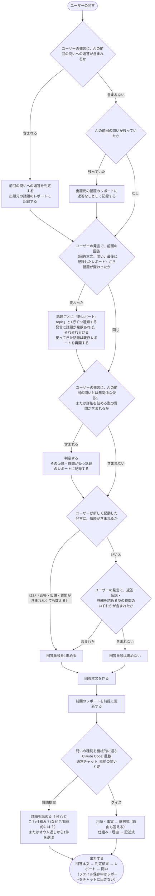

# rikai-session-mode Specification

## Purpose
AIの回答ごとにユーザーの理解を確かめ、理解を促進するため、rikai をセッション持続モードで起動・終了し、毎回の出力に判定結果・理解度レポート・問いを一定の順序で付ける。
## Requirements
### Requirement: 全ての回答に問いとレポートを付ける
モード有効中、rikai は全ての回答に問いと理解度レポートを付けなければならない（SHALL）。説明を含まない回答にも付け、その場合は作業内容（何を・なぜ）を素材にする。回答番号を進めないターンにも、同じく付ける。ただし、起動を知らせる応答（問いもレポートも付けない）と、終了の応答（最終レポートのみ付け、問いは付けない）を除く。ファイルに保存している間は、レポートをチャットに出さない（rikai-understanding-report に従う）。（確定）

#### Scenario: 説明を含まない回答
- **WHEN** モード有効中に、説明を含まない回答を返す
- **THEN** 作業内容（何を・なぜ）を素材に、問いと理解度レポートを付ける

#### Scenario: 回答番号を進めないターン
- **WHEN** モード有効中に、前回の問いへの返答も、仮説も、詳細を詰める型の質問も含まない発言へ回答する
- **THEN** 回答番号は進めず、問いと理解度レポートを付ける

#### Scenario: 起動の応答
- **WHEN** rikai を起動した直後の応答を返す
- **THEN** 問いも理解度レポートも付けない

#### Scenario: 終了の応答
- **WHEN** 終了指示への応答を返す
- **THEN** 全話題の最終の理解度レポートを付け、問いは付けない。ファイルに保存している場合は、最終レポートの代わりに、保存した全話題のファイルのパスを、1行にまとめて並べる

### Requirement: セッション持続モードで動作する
rikai は、一度起動されると以後の全回答に問いと理解度レポートを付け、終了語で解除されるまで有効でなければならない（SHALL）。（確定）モードが有効かどうかは、会話の文脈で決まる。バッジ用のフラグには依存しない。

終了指示への応答は、判定結果（前回の問いへの返答があったときのみ）、全話題の最終の理解度レポート（話題ごとに順に1回だけ）の順にする。回答本文と問いは付けない。ファイルに保存している場合は、最終の理解度レポートの代わりに、保存した全話題のレポートのファイルのパスを、1行にまとめて並べる（rikai-understanding-report に従う）。終了のターンでも、前回の問いへの返答の判定と、返答なしの記録を行ってから出す。新しい話題への仮説があれば、その話題のレポートを作って記録する。終了時に、話題とレポートの状態は破棄し、再び起動しても引き継がない。（確定）

会話圧縮や `/clear` など、外部要因でモードが失われることは許容する。失われた場合は、再度 `/rikai` で起動する。復元の手段は設けない。（確定）

#### Scenario: 起動後の回答
- **WHEN** ユーザーが rikai を一度起動し、続けて発言する
- **THEN** 以後の全回答に問いと理解度レポートが付く

#### Scenario: 終了語による解除
- **WHEN** ユーザーが終了語を送る
- **THEN** 終了指示への応答に全話題の最終の理解度レポートを付け（問いは付けない）、それより後の回答には問いも理解度レポートも付けない。ファイルに保存している場合は、最終レポートの代わりに、保存した全話題のファイルのパスを、1行にまとめて並べる

#### Scenario: 終了のターンに前回の問いが残っていた場合
- **WHEN** 前回の問いが残っている状態で、ユーザーが終了語を送る
- **THEN** 前回の問いへの返答があれば判定し、無ければ返答なしとして記録してから、最終の理解度レポートを出す

#### Scenario: 外部要因によるリセット
- **WHEN** 会話圧縮や `/clear` により、モードが有効だった記憶が失われる
- **THEN** モードは解除されたものとして扱い、ユーザーが再度 `/rikai` で起動する

### Requirement: 起動と終了の指示を受け付ける
rikai は、起動を `/rikai`、終了を `/rikai off` で受け付けなければならない（SHALL）。通常チャットでは、自然言語（「rikaiを始めて」「rikai終了」）でも切り替えられなければならない（SHALL）。（既定）

スキルの frontmatter に `name: rikai` を置き、プラグインの名前空間なしの `/rikai` でも呼べるようにする。同名の別コマンドとぶつかる場合は、`/rikai:rikai` で呼ぶ。（確定。公式ドキュメントに基づく。`claude -p --plugin-dir` で、`/rikai` と入力するだけでスキルが起動することを確認した）

終了の指示は、ユーザー自身がモードの終了を命じる発話に限る。rikai を話題にしただけの発話（「rikaiの終了条件を教えて」など）は、終了として扱わない。（確定）

すでにモードが有効なときの `/rikai` は、状態をリセットせず、すでに有効である旨を1行で伝える。モードが有効でないときの `/rikai off` は、有効ではない旨を1行で伝える。（確定）

#### Scenario: コマンドによる起動
- **WHEN** ユーザーが `/rikai` を送る
- **THEN** モードが有効になる

#### Scenario: コマンドによる終了
- **WHEN** モード有効中にユーザーが `/rikai off` を送る
- **THEN** モードが解除される

#### Scenario: 通常チャットでの自然言語による切り替え
- **WHEN** 通常チャットでユーザーが「rikaiを始めて」または「rikai終了」と送る
- **THEN** モードが有効または解除される

#### Scenario: 二重起動
- **WHEN** モード有効中にユーザーが `/rikai` を送る
- **THEN** 回答番号とレポートをそのまま続け、すでに有効である旨を1行で伝える。同じ発言に依頼が含まれる場合は、その1行のあと、依頼を通常の回答として処理する

#### Scenario: 有効でないときの終了
- **WHEN** モードが有効でないときにユーザーが `/rikai off` を送る
- **THEN** 有効ではない旨を1行で伝える

### Requirement: 起動時にレポート形式を一度だけ提案する
ファイル保存が可能な環境では、rikai は起動時にレポート形式を一度だけ提案しなければならない（SHALL）。返答を待たず、無応答ならチャット内表示で進めなければならない（SHALL）。（確定）

#### Scenario: ファイル保存が可能な環境での起動
- **WHEN** ファイル保存が可能な環境で rikai を起動する
- **THEN** レポート形式を一度だけ提案し、返答を待たずに進める

#### Scenario: 形式の提案に無応答
- **WHEN** レポート形式の提案にユーザーが応答しない
- **THEN** チャット内表示で進める

### Requirement: 毎回の出力を一定の順に並べる
rikai は、モード有効中の毎回の出力を、次の順に並べなければならない（SHALL）。

1. 回答本文
2. 前回の問いに対するユーザーの返答があれば、その判定結果（採点・正解の提示）
3. 理解度レポート（Markdown コードブロック）。ファイルに保存している間は、チャットに出さない
4. 問い1問（最後尾の専用セクション）

問いを最後に置くのは、ユーザーが次の発言を書く直前に目に入る位置にするため。（確定）項目 1〜3 の並びは既定。

順序は崩さず、中身が無い要素だけを省く。（確定）

- 返答のみのターン（新しい依頼が無く、回答本文が空になる）: 回答本文は作らず、判定結果、理解度レポート、問いの順にする。判定結果に、正解や補足の解説を含める。問いの素材は、直前までの説明と判定結果にする。
- 詳細を詰める型の質問（何？／どこ？／仕組み？／なぜ？／具体的には？）で尋ねられたターン: ユーザーの質問への答えが回答本文になる。判定は「理解できてない」として記録する。採点と正解の提示は省き、判定結果の位置には「『○○』を理解できていない箇所として記録した」と1行だけ書く。
- 回答番号を進めないターン（前回の問いへの返答も、仮説も、詳細を詰める型の質問も含まない発言への回答）: 判定結果は無いので省き、回答本文、理解度レポート、問いの順にする。（確定）理解度レポートの回答番号は、前回のまま変えない。前回の問いが残っていれば、返答なしとして通知せずに記録し、レポートの変化で気づかせる。
- 付随の通知（「新レポート: <topic>」の通知、`.gitignore` の案内、レポートの書き込み失敗の1行）は、回答本文の直前に、1つにつき1行で置く。本文が無いターンでは先頭に置く。レポート形式の提案と `flag.mts` のエラーは、起動と終了の応答の扱いに従う。（既定。暫定）
- 理解度レポートとして出すのは、そのターンの話題のレポートと、判定や返答なしを記録した他の話題のレポートとする。変化が無いターンでも、そのターンの話題のレポートは出す。ただし、終了の応答では全話題のレポートを出す。ファイルに保存している間は、チャットには出さない。（確定）

問いセクションの見出し名は未決である。

#### Scenario: 前回の問いへの返答がある場合の出力
- **WHEN** ユーザーが前回の問いに返答した後、AIが回答する
- **THEN** 回答本文、判定結果、理解度レポート、問いの順に出力し、問いが最後尾の専用セクションに置かれる

#### Scenario: 返答のみのターン
- **WHEN** ユーザーが前回の問いに返答しただけで、新しい依頼が無い
- **THEN** 回答本文を省き、判定結果（正解や補足の解説を含む）、理解度レポート、問いの順に出力する

#### Scenario: 詳細を詰める型の質問をされた場合
- **WHEN** ユーザーが質問提案を受けて「○○は何？」「○○ってどこ？」「どういう仕組み？」「なぜ○○？」「具体的には？」のいずれかで尋ねる
- **THEN** 質問への答えを回答本文とし、判定結果の位置に「理解できてない箇所として記録した」旨を1行だけ書き、採点と正解の提示は省く

#### Scenario: 回答番号を進めないターンの出力
- **WHEN** ユーザーが前回の問いに答えず、仮説も詳細を詰める型の質問も含まない依頼をする
- **THEN** 判定結果を省き、回答本文、理解度レポート、問いの順に出力する。レポートの回答番号は前回のままで、前回の問いの「返答なし」だけが反映される

#### Scenario: 付随の通知
- **WHEN** 話題が変わって「新レポート: <topic>」を通知する、または `.gitignore` の案内を出す
- **THEN** 回答本文の直前に、通知1つにつき1行で置く

#### Scenario: 複数の話題があるときのレポートの出力
- **WHEN** 話題が複数に分かれているとき、話題Aで回答し、話題Bの判定は記録していない
- **THEN** 話題Aのレポートだけを出す。話題Bについての仮説の判定を記録した場合は、話題Bのレポートも出す

#### Scenario: ファイル保存中の出力
- **WHEN** ファイルへの保存を選んだ状態で、AIが回答する
- **THEN** 回答本文、判定結果（あれば）、問いの順に出力し、理解度レポートはチャットに出さない

### Requirement: 1ターンを一定の流れで処理する
rikai は、モード有効中の1ターンを、次の流れで処理しなければならない（SHALL）。この流れは他の要件の内容を図にしたもので、新しい決定は加えない。各ステップの確度（確定・既定）は、参照先の要件に従う。

判定は rikai-understanding-judgement、レポートの更新と話題の分割は rikai-understanding-report、問いの種類の選択と回答番号の数え方は rikai-question-selection、出力順は「毎回の出力を一定の順に並べる」に従う。未回答の問いは、前回の問い1つだけである（毎回の問いは1問のため）。

#### Scenario: 返答を含む発言
- **WHEN** ユーザーの発言に、前回の問いへの返答（クイズの回答、提案された質問、言い換え）が含まれる
- **THEN** 判定して出題元の話題のレポートに記録してから、話題の変化の確認に進む

#### Scenario: 返答を含まず、前回の問いが残っていた場合
- **WHEN** ユーザーの発言に前回の問いへの返答が含まれず、前回の問いが残っていた
- **THEN** 出題元の話題のレポートに返答なしとして記録してから、話題の変化の確認に進む。発言が別の話題への仮説を含んでいても、記録は変わらない

#### Scenario: 返答を含まず、前回の問いも残っていない場合
- **WHEN** ユーザーの発言に前回の問いへの返答が含まれず、前回の問いも残っていない
- **THEN** 返答の判定も記録もせず、話題の変化の確認に進む

#### Scenario: 話題が変わった発言
- **WHEN** ユーザーの発言で、話題が変わったとAIが判断する
- **THEN** 「新レポート: topic」と1行で通知してレポートを分けてから、AIの前回の問いとは無関係な仮説や質問が含まれるかの確認に進む。戻ってきた話題は既存レポートを再開する

#### Scenario: 話題が変わっていない発言
- **WHEN** ユーザーの発言で、話題が変わっていないとAIが判断する
- **THEN** レポートを分けずに、AIの前回の問いとは無関係な仮説や質問が含まれるかの確認に進む

#### Scenario: 問いとは無関係な仮説を含む発言
- **WHEN** ユーザーの発言に、AIの前回の問いとは無関係な仮説、または詳細を詰める型の質問が含まれる
- **THEN** 判定して、その仮説・質問が扱う話題のレポートに記録してから、回答番号の確認に進む。新しい話題への仮説なら、分けた新しい話題のレポートに記録する。発言に複数の話題への仮説があれば、それぞれの話題のレポートに記録する

#### Scenario: 返答も仮説も質問も含まない発言
- **WHEN** 起動後の2回目以降で、ユーザーの発言に、前回の問いへの返答も、仮説も、詳細を詰める型の質問も含まれない
- **THEN** 回答番号を進めずに、回答本文の作成に進む

#### Scenario: 回答番号を進める発言
- **WHEN** ユーザーの発言に、返答、仮説、詳細を詰める型の質問のいずれかが含まれる
- **THEN** 回答番号を1進めてから、回答本文の作成に進む

### Requirement: 起動の応答は有効化の通知と形式の提案だけにする
rikai は、起動を知らせる応答に、モードが有効になった旨の1行と、レポート形式の提案（ファイル保存が可能な環境のみ）だけを書かなければならない（SHALL）。素材が無いため、理解度レポートも問いも付けない。この応答は回答番号に数えず、次の回答を 1 とする。同じ発言に依頼が含まれる場合は、この応答のあと、その依頼を通常の回答として処理する。この回答が起動後の最初の回答で、回答番号は 1 とする。（確定）

#### Scenario: 起動の応答の内容
- **WHEN** rikai を起動した直後に応答する
- **THEN** 有効になった旨の1行（とファイル保存が可能な環境ではレポート形式の提案）だけを出し、回答番号には数えない

#### Scenario: 起動の発言に依頼が含まれる
- **WHEN** 「rikaiを始めて。Xを説明して」のように、起動の発言に依頼が含まれる
- **THEN** 起動の1行のあと、Xへの回答を通常の回答（回答番号 1、判定結果・レポート・問いの順）として出す

