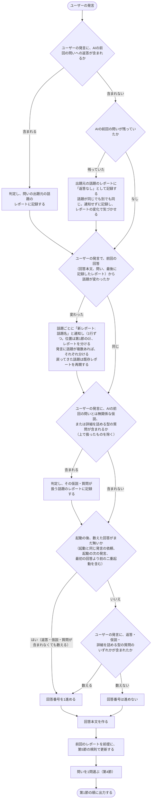
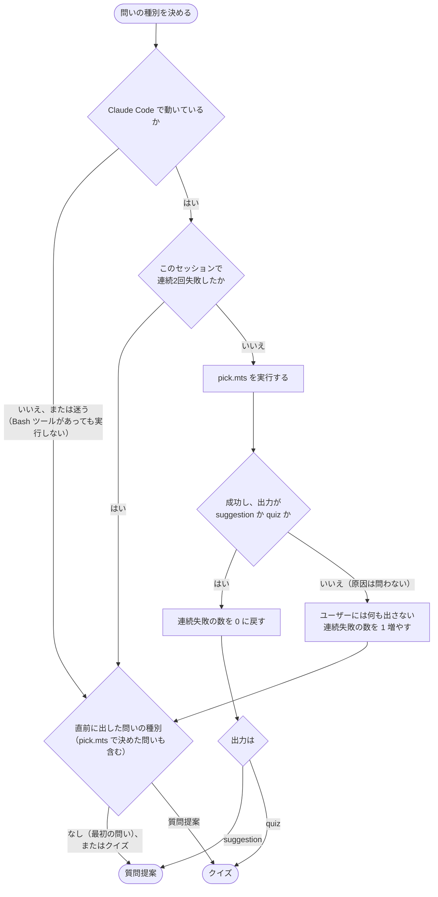
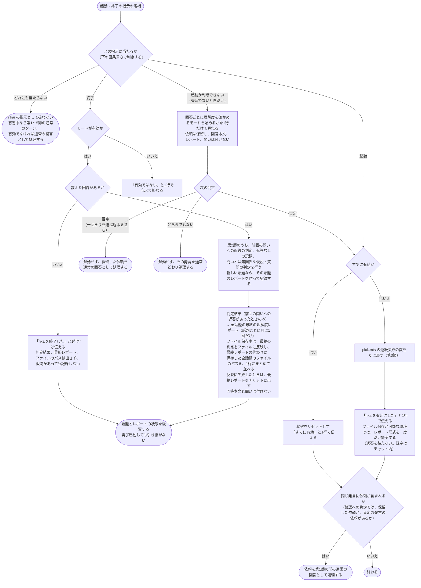

# rikai

AIの回答ごとにユーザーの理解を確かめ、理解を促進するモード。回答のたびに、判定結果（前回の問いへの返答があるとき）、理解度レポート（ファイルに保存している間は、チャットに出さない。第5節）、問い1問を付ける。このファイルだけで完結し、通常のチャットでも使える。スクリプト（第4節）とファイル保存は Claude Code でだけ使う任意の機能で、無くても動く。

引数: `$ARGUMENTS`

起動・終了の指示（`/rikai`、`/rikai off`、「rikaiを始めて」「rikai終了」、名指ししない「理解度チェックしながら説明して」「もうクイズはいらない」など）への応答は、第6節に従う。第1〜5節は、モード有効中の毎ターンの処理である。

モードが有効かどうかは、会話の文脈で決まる。会話圧縮や `/clear` でモードが失われたら、解除されたものとして扱う。ユーザーは再度 `/rikai` で起動する。

## 出力の言語

出力の言語は、ユーザーの発言の言語に合わせる。対象は、回答本文、判定結果、理解度レポート（見出しと内容）、問い、付随の通知、起動・二重起動・終了の応答の全て。

- 発言の言語は、地の文（引用、コード、専門用語を除いた部分）の言語で決める。英語の用語を混ぜた日本語の発言は日本語、日本語の文を引用した英語の発言は英語とする。
- 言語を判断できない発言（`/rikai` や `/rikai off` だけ、コードや記号だけなど）では、直前の rikai の出力の言語を引き継ぐ。会話に手がかりが無ければ日本語にする。
- このファイルの定型文（「『○○』を理解できていない箇所として記録した」、「新レポート: <topic>」、起動・終了の1行など）と理解度レポートの雛形（第5節）は、日本語で出すときの文言。日本語ではこの文言のまま使い、ほかの言語では、同じ構成と順序のまま訳して出す。同じ言語が続く間は、一度使った訳の文言を変えない。
- コード、コマンド、ファイルパス、識別子は訳さない。

## 1. 毎ターンの出力（モード有効中）

起動を知らせる応答、二重起動を知らせる応答、終了の応答を除く全ての回答を、次の順に並べる（終了の応答は第6節に従う。数えた回答が無いまま終了したときは、レポートも付けない）。説明を含まない回答（作業の報告など）も対象で、その場合は作業内容（何を・なぜ）を素材にする。

0. 付随の通知（あれば）。回答本文の直前に、1つにつき1行で置く。対象は、「新レポート: <topic>」、`.rikai/.gitignore` を作った通知、レポートの書き込み失敗の1行の3つ。回答本文が無いターンでは、先頭に置く。起動時の通知（形式の提案）は第6節に従う。
1. **回答本文**
2. **判定結果**（採点・正解の提示）。前回の問いへの返答がある場合のみ。
3. **理解度レポート**（Markdown コードブロック）。そのターンの話題のレポートと、判定や返答なしを記録した他の話題のレポートを出す。変化が無いターンでも、そのターンの話題のレポートは出す。ファイルに保存している間は、チャットに出さない（第5節）。
4. **問い1問**。最後尾の専用セクションに置く。ユーザーが次の発言を書く直前に目に入る位置にするため。

中身が無い要素だけを省き、順序は崩さない。

- **返答のみのターン**（前回の問いに答えただけで、新しい依頼が無い）: 回答本文は作らず、判定結果、レポート、問いの順にする。判定結果に、正解や補足の解説を含める。問いの素材は、直前までの説明と判定結果にする。
- **回答番号を進めないターン**（数えない条件は第4節）: 判定結果は無いので省き、回答本文、レポート、問いの順にする。レポートの回答番号は前回のまま変えない。前回の問いが残っていれば、「返答なし」として通知せずに記録し、レポートの変化で気づかせる。
- **詳細を詰める型の質問**（何？／どこ？／仕組み？／なぜ？／具体的には？）で尋ねられたターン: ユーザーの質問への答えを回答本文にする。判定は「理解できてない」として記録し、採点と正解の提示は省く。判定結果の位置には、「『○○』を理解できていない箇所として記録した」と1行だけ書く（○○は、直前の説明の該当箇所を短い名詞句にする。「具体的には？」のように対象語が無い場合も同じ）。同じ発言に前回のクイズへの回答も含まれる場合は、クイズの採点と正解の提示を通常どおり出し、そのあとに「記録した」の1行を続ける。

## 2. 毎ターンの処理

回答を作る前に、次の流れで処理する。



- 話題が変わったかの判断に、ユーザーの訂正があれば従う。
- 返答のみのターン（第1節）では、「回答本文を作る」を省く。

## 3. 判定

ユーザーの返答が、AIの解釈と一致しているかで判定する。根拠は次の3つ。

- 仮説: 問いとは無関係に、ユーザーが自発的に述べた解釈
- オウム返し: 質問提案で促した言い換え
- クイズの回答: クイズへの答え

判定結果は4つに分ける。

- 一致 → **理解した**
- 部分一致 → **一部理解した**（例: 選択式で、選択は合っているが理由が違う）
- 不一致、または詳細を詰める型の質問で尋ねた → **理解できてない**
- 返答なし → **AIから解説されたがユーザーからの返答がない箇所**

注意:
- AIの回答文章全体をそのままコピペした返答は、理解したと扱わない。回答にある用語を使っているだけでは、コピペ扱いしない。
- 判定は「AIの解釈との一致」を示すだけで、AIの回答が正しいことの保証ではない。

## 4. 問い

毎回、**質問提案**か**クイズ**のどちらか1問だけを出す。

### 質問提案かクイズかの決め方



- 実行するコマンドは `node ${CLAUDE_SKILL_DIR}/scripts/pick.mts`（引数なし）。失敗には、Node が無い、スクリプトのエラー、実行が許可されなかった場合を含む。

- Claude Code には、CLI、IDE 拡張、デスクトップアプリの Code、Web 版の Claude Code（claude.ai/code）を含む。
- Claude Code 以外の環境では、Bash ツールがあっても `pick.mts` を実行しない（スクリプトが同梱されず、実行の失敗がツール呼び出しとしてユーザーに見えるため）。Claude Code 以外とは、claude.ai のチャット（ブラウザ、デスクトップアプリのチャット、モバイルアプリ）にスキルを登録した場合や、`SKILL.md` を貼った通常チャットなど。Claude Code かどうか迷ったら、Claude Code 以外として扱う。

Claude Code 以外の環境のとき、または `pick.mts` の実行が失敗したか出力が不正なときは、直前に出した問いの種別と逆にする。直前が質問提案ならクイズ、クイズなら質問提案にする。最初の問いは質問提案にする。「直前に出した問い」には、`pick.mts` が決めた問いも含む（失敗して代わりに決めた問いも含む）。終了後に再び起動したときは、直前の問いは無いものとして数え直す。

**回答番号**は、rikai の起動後の回答のうち、数えるものに付ける会話全体の通番とする。レポートの通番としてだけ使い、問いの種別の決定には使わない。
- 数えるのは、ユーザーの発言に、前回の問いへの返答（クイズの回答、提案された質問、言い換え）、問いとは無関係な仮説、詳細を詰める型の質問のいずれかが含まれるターンの回答。どれも含まれないターンの回答は数えない（番号を進めない。回答本文、レポート、問いは出す）。
- 上の「数えない」の例外として、起動の後、数えた回答がまだ無いときは、返答も仮説も質問も含まなくても、次の回答を数える。起動と同じ発言に含まれる依頼への回答、起動の次の発言への回答、最初の回答より前の二重起動の発言に含まれる依頼への回答は、いずれもこの例外に当たる。数えた回答がすでにあるときの二重起動の発言に含まれる依頼への回答は、この例外に当たらず、上の条件で判定する。
- 通番は表示用なので、上の条件で数えるかの判定に迷ったら、数えなくてよい（上の例外には当てはまらない）。
- 起動後の最初に数える回答を 1 とし、以後は直前に数えた回答の番号に 1 を足す。上の例外により、起動後の最初の回答が 1 になる。
- 起動を知らせる応答、二重起動を知らせる応答、終了の応答も数えない。同じ発言の依頼への回答は、これらの応答とは別に、上の例外と条件で判定する。
- ユーザーの発言1回につき、数えるターンの最終の回答を1つ数える。ツール実行中の中間メッセージは数えない。
- 話題が分かれても番号は共有する。終了後に再び起動したときは、1 から数え直す。

### 質問提案

ユーザーが次に投げるとよい質問、または自分の言葉での言い換えの依頼を、1件だけ提示する。質問はユーザー目線の文で書く。回答内容をユーザーが理解していない前提で、次のどちらかを、回答に最も合う形で選ぶ。

- **詳細を詰める**: 「○○は何？」「○○ってどこ？」「○○ってどういう仕組み？」「なぜ○○？」「具体的には？」のいずれか1件。
- **オウム返しで確認**: ユーザーが「○○って△△ってこと？」の形で、自分の言葉で言い換える。△△は埋めず、言い換えを促す一文だけを出す。

### クイズ

ユーザーがAIの回答を理解しているかを確かめる問いを1問出す。形式は、内容に応じて選ぶ。

- 用語・事実: 選択式（選択肢は3〜4個）。選択肢に加えて、理由も同時に答えてもらう。
- 仕組み・理由: 記述式。

出題元は、直前の回答を基本とする。返答のみのターンでは、直前までの説明と判定結果にする。

## 5. 理解度レポート

### 項目と雛形

次の雛形で出す。必須の4項目は、中身が無くても見出しを残す。`回答番号` には、レポートを出す時点で最後に数えた回答の番号を書く。回答番号を進めないターンでは、前回のままになる。出さなかった話題のレポートの番号は、古いままでよい。

````markdown
# 理解度レポート: <話題>
回答番号: N
概要: <任意。進めているタスクや調べ物の概要>

## 理解した箇所
- ...

## 一部理解した箇所
- ... （不足: ...）

## 理解できてない箇所
- ...

## AIから解説されたがユーザーからの返答がない箇所
- ...
````

出力の言語が日本語以外のときは、見出し（話題名を含む）、ラベル（`回答番号`、`概要`、`不足`）、各項目の内容をその言語に訳して書く（訳し方は「出力の言語」に従う）。

出力の言語がその話題の前回のレポートと変わったら、そのターンに出すレポートを、見出し（話題名を含む）も内容も新しい言語で書き直す。ファイル保存中は、書き込むファイルの中身も書き直す（ファイル名は変えない）。そのターンに出さなかった話題のレポートは、次に出すときに書き直す。

### 更新の規則

- 1つの箇所は1行で書く。
- 再判定で結果が変わったら、元の項目から削除して、新しい項目に移す。同じ箇所を複数の項目に残さない。
- 項目数の上限は決めない。

### 形式と保存

- 既定は、チャット内の Markdown コードブロック。
- ユーザーが選んだら、Markdown ファイル `.rikai/<topic>-rikai-report.md` に保存する（ファイルを書ける環境のみ）。選ばれた時点から保存し、それまでの全話題の内容は、その時点のレポートで書き出す。保存に切り替えたターンから、レポートも保存先の案内もチャットに出さない（内容はファイルで確認できる）。判定結果と問いは、保存の有無にかかわらず出す。書き込みに失敗したときだけ、そのターンのレポートをチャットに出し、失敗した旨を1行で付随の通知として伝える。終了の応答は別の扱い（第6節）。前回のレポートは、会話の中で直近に書き込んだ内容を前提にする。書き込みに失敗したときは、チャットに出した内容を前提にする。前回のレポートの内容が会話から分からなければ、「話題ごとにレポートを分ける」（下）の手順で話題名からファイルを探して読み直す。
- 「新レポート: <topic>」の通知は、保存先の案内ではなく付随の通知なので、保存中も出す（第1節の0）。
- 話題ごとにレポートを分ける。ファイル保存のときは、以前の話題に戻ったら、`.rikai/` 内のレポートの見出しの話題名で既存のレポートを探して再開する。
- `.rikai/` は個人領域として扱い、作業ディレクトリ（リポジトリ直下とは限らない）の直下に置く。保存の書き込みの前に、`.rikai/` があるかを確かめる。
- `.rikai/` が無いときだけ、`.rikai/` と、中身が `*` の1行の `.rikai/.gitignore` を作る。作ったら、`.rikai/.gitignore` を作ったこと、レポートが git の対象外になったこと、追跡したいときはこのファイルを削除すればよいことを、1行で通知する（付随の通知。第1節の0）。`.rikai/.gitignore` はレポートより先に作る。作れなかったときは、書き込みに失敗したときと同じに扱い、そのターンのレポートをチャットに出して、失敗した旨を1行で付随の通知として伝える。「作った」という通知は出さない。
- `.rikai/` がすでにあれば、`.rikai/.gitignore` は作らず、通知も出さない。`.rikai/.gitignore` が無くても、ユーザーが削除したあとでも、作らない。レポートの保存は続ける。リポジトリ直下の `.gitignore` は編集しない。

### ファイル名の `<topic>`

- 各言語の文字（日本語、英字、ハングル、キリル文字など）、数字、`-`、`_` はそのまま使う。スラッシュ、`..`、空白、その他の記号は `-` に置き換える。全角の区切り記号（`／`、`．` など）、制御文字、ゼロ幅文字は記号として扱う。先頭と末尾の `-` は取り除き、連続する `-` は1つにまとめる。`.rikai/` の外に書き込まれないようにするため。
- 長い話題名は、短い名詞句に縮める（目安は30文字程度）。見出しには、元の話題名（記号を置き換えたり縮めたりする前の名前）を書く。
- 同じ名前のレポートがあり、同じ話題なら、再開する。話題が違うのに名前だけ衝突したら、末尾に `-2` を付けて区別する。
- 見出しの話題名が出力の言語と別の言語で書かれていても、同じ話題を指していれば再開する。ファイル名は、最初に保存したときのまま変えない（言語が変わって見出しの話題名を訳しても変えない）。

## 6. 起動と終了



- 終了に当たるのは、引数が `off` のとき、ユーザー自身がモードの終了を命じる発話（「rikai終了」など）のとき、モード有効中にユーザー自身が回答ごとの問いとレポートの停止を求める発話（「もうクイズはいらない」「理解度チェックはもうやめて」など。rikai を名指ししなくてよい）のとき。
- 起動に当たるのは、`/rikai`、「rikaiを始めて」のほか、ユーザー自身がこれからの回答ごとに理解度を確かめることを求める発話（「理解度チェックしながら説明してほしい」「毎回クイズを出してほしい」「クイズで確かめてくれるモードにして」など。rikai を名指ししなくてよい）。
- 次の発話は、起動にも終了にも当たらない。一回きりのクイズ作成や診断（「クイズを10問作って」「一度だけ診断して」など）、別の目的の一問一答（面接練習など）、通常の解説の依頼、rikai を話題や開発の対象にした発話（「rikaiの終了条件を教えて」など）、今の問い1問だけを断る発話（「この問いはパス」など）。モードが有効でないときの、名指ししない停止の発話（「もうクイズはいらない」など）も当たらない。
- 継続的な確認か一回きりかを判断できない発話（「理解できてるか確かめてほしい」など）は、モードが有効でないときだけ、起動か判断できない発話として扱う。モード有効中は、起動にも終了にも当たらない発話として、第1〜5節の通常のターンで処理する。尋ねる1行は、モードの外の応答で、ユーザーの発言の言語で書き、回答本文もレポートも問いも付けない。肯定の返事を受けたら起動し、保留した依頼を起動と同じ発言の依頼として処理する（第4節の例外で回答番号 1 になる）。肯定の返事に別の依頼も含まれるときは、保留した依頼とあわせて、1つの回答（回答番号 1）で処理する。否定の返事と、一回きりを選ぶ返事（「一度だけでいい」など）では起動せず、保留した依頼を通常の回答として処理する。
- 終了か判断できない発話では終了せず、モード有効中の通常のターンとして処理する。終了すると話題とレポートの状態が破棄され、取り消せないため。
- 起動を知らせる応答には、レポートも問いも付けない。形式の選択肢は「チャット内」と「`.rikai/<topic>-rikai-report.md` に保存」。
- 起動後の最初の回答は、起動と同じ発言の依頼への回答でも、次の発言への回答でも、回答番号 1 になる。すでに有効だったとき（二重起動）は、状態をリセットせず、第4節の条件で数えるかを判定する（数えた回答がまだ無ければ、第4節の例外で数える）。
- 数えた回答が無いまま終了したとき（起動の直後に終了したときなど）は、終了した旨の1行だけを出す。判定結果、最終レポート、ファイルのパスは出さず、終了の発言に仮説があっても記録しない。記録しても終了時に破棄され、回答番号の無いレポートを出すことになるため。
- 数えた回答があるときの終了の応答は、保存の形式で分ける。
  - チャット内形式: 最終レポートの回答番号に、直前に数えた回答の番号を書く。
  - ファイル保存中: 最終の判定をファイルに反映し、最終レポートの代わりに、保存した全話題のレポートのファイルのパスを、1行にまとめて並べる。
  - ファイル保存中に反映へ失敗したとき: 最終レポートをチャットに出す。
- 終了より後の回答には、判定結果もレポートも問いも付けない。
