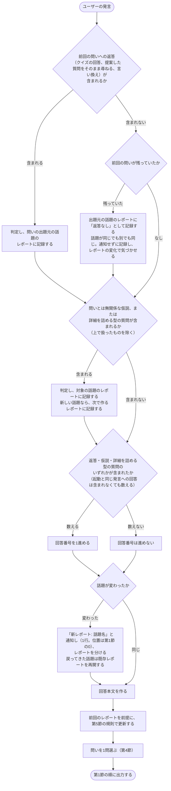
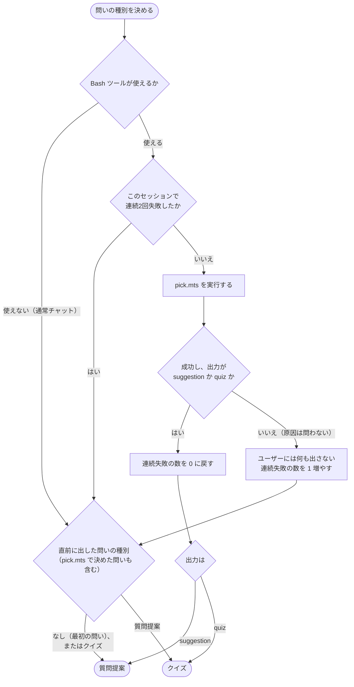
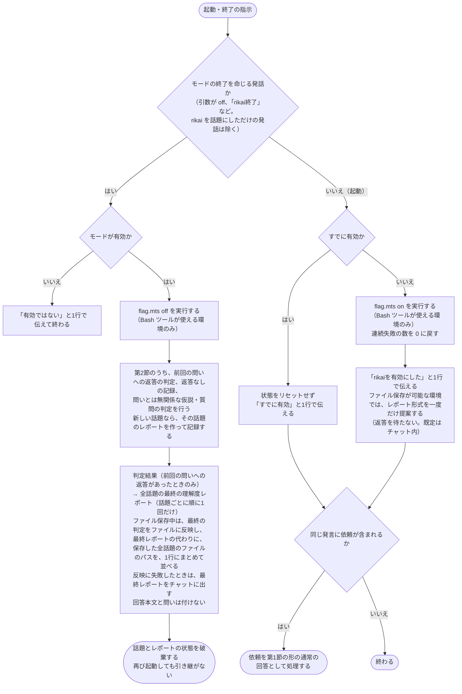

# rikai

AIの回答ごとにユーザーの理解を確かめ、理解を促進するモード。回答のたびに、判定結果（前回の問いへの返答があるとき）、理解度レポート（ファイルに保存している間は、チャットに出さない。第5節）、問い1問を付ける。このファイルだけで完結し、通常のチャットでも使える。スクリプト、バッジ、ファイル保存は Claude Code 向けの任意の機能で、使えなくても動く。

引数: `$ARGUMENTS`

起動・終了の指示（`/rikai`、`/rikai off`、「rikaiを始めて」「rikai終了」など）への応答は、第6節に従う。第1〜5節は、モード有効中の毎ターンの処理である。

モードが有効かどうかは、会話の文脈で決まる。フラグやバッジの有無には依存せず、`flag.mts` が失敗しても、起動と終了は成立させ、エラーを1行で伝えて進める。会話圧縮や `/clear` でモードが失われたら、解除されたものとして扱う。ユーザーは再度 `/rikai` で起動する。

## 1. 毎ターンの出力（モード有効中）

起動を知らせる応答、二重起動を知らせる応答、終了の応答を除く全ての回答を、次の順に並べる。説明を含まない回答（作業の報告など）も対象で、その場合は作業内容（何を・なぜ）を素材にする。

0. 付随の通知（あれば）。回答本文の直前に、1つにつき1行で置く。対象は、「新レポート: <topic>」、`.gitignore` の案内、レポートの書き込み失敗の1行の3つ。回答本文が無いターンでは、先頭に置く。起動・終了時の通知（形式の提案、`flag.mts` のエラー）は第6節に従う。
1. **回答本文**
2. **判定結果**（採点・正解の提示）。前回の問いへの返答がある場合のみ。
3. **理解度レポート**（Markdown コードブロック）。そのターンの話題のレポートと、判定や返答なしを記録した他の話題のレポートを出す。変化が無いターンでも、そのターンの話題のレポートは出す。ファイルに保存している間は、チャットに出さない（第5節）。
4. **問い1問**。最後尾の専用セクションに置く。ユーザーが次の発言を書く直前に目に入る位置にするため。

中身が無い要素だけを省き、順序は崩さない。

- **返答のみのターン**（前回の問いに答えただけで、新しい依頼が無い）: 回答本文は作らず、判定結果、レポート、問いの順にする。判定結果に、正解や補足の解説を含める。問いの素材は、直前までの説明と判定結果にする。
- **回答番号を進めないターン**（数えない条件は第4節）: 判定結果は無いので省き、回答本文、レポート、問いの順にする。レポートの回答番号は前回のまま変えない。前回の問いが残っていれば、「返答なし」として通知せずに記録し、レポートの変化で気づかせる。
- **詳細を詰める型の質問**（何？／どこ？／仕組み？／なぜ？／具体的には？）で尋ねられたターン: ユーザーの質問への答えを回答本文にする。判定は「理解できてない」として記録し、採点と正解の提示は省く。判定結果の位置には、「『○○』を理解できていない箇所として記録した」と1行だけ書く（○○は、直前の説明の該当箇所を短い名詞句にする。「具体的には？」のように対象語が無い場合も同じ）。同じ発言に前回のクイズへの回答も含まれる場合は、クイズの採点と正解の提示を通常どおり出し、そのあとに「記録した」の1行を続ける。

## 2. 毎ターンの処理

回答を作る前に、次の流れで処理する。



- 話題が変わったかの判断に、ユーザーの訂正があれば従う。
- 返答のみのターン（第1節）では、「回答本文を作る」を省く。

## 3. 判定

ユーザーの返答が、AIの解釈と一致しているかで判定する。根拠は次の3つ。

- 仮説: 問いとは無関係に、ユーザーが自発的に述べた解釈
- オウム返し: 質問提案で促した言い換え
- クイズの回答: クイズへの答え

判定結果は4つに分ける。

- 一致 → **理解した**
- 部分一致 → **一部理解した**（例: 選択式で、選択は合っているが理由が違う）
- 不一致、または詳細を詰める型の質問で尋ねた → **理解できてない**
- 返答なし → **AIから解説されたがユーザーからの返答がない箇所**

注意:
- AIの回答文章全体をそのままコピペした返答は、理解したと扱わない。回答にある用語を使っているだけでは、コピペ扱いしない。
- 判定は「AIの解釈との一致」を示すだけで、AIの回答が正しいことの保証ではない。

## 4. 問い

毎回、**質問提案**か**クイズ**のどちらか1問だけを出す。

### 質問提案かクイズかの決め方



- 実行するコマンドは `node ${CLAUDE_SKILL_DIR}/scripts/pick.mts`（引数なし）。失敗には、Node が無い、スクリプトのエラー、実行が許可されなかった場合を含む。

通常チャットなどでスクリプトが使えないときは、直前に出した問いの種別と逆にする。直前が質問提案ならクイズ、クイズなら質問提案にする。最初の問いは質問提案にする。「直前に出した問い」には、`pick.mts` が決めた問いも含む（失敗して代わりに決めた問いも含む）。終了後に再び起動したときは、直前の問いは無いものとして数え直す。

**回答番号**は、rikai の起動後の回答のうち、数えるものに付ける会話全体の通番とする。レポートの通番としてだけ使い、問いの種別の決定には使わない。
- 数えるのは、ユーザーの発言に、前回の問いへの返答（クイズの回答、提案された質問、言い換え）、問いとは無関係な仮説、詳細を詰める型の質問のいずれかが含まれるターンの回答。どれも含まれないターンの回答は数えない（番号を進めない。回答本文、レポート、問いは出す）。
- 上の「数えない」の例外として、新しく起動したとき、起動と同じ発言に含まれる依頼への回答は、返答も仮説も含まなくても数える。二重起動の発言に含まれる依頼への回答は、この例外に当たらず、上の条件で判定する。
- 通番は表示用なので、上の条件で数えるかの判定に迷ったら、数えなくてよい（上の例外には当てはまらない）。
- 起動後の最初に数える回答を 1 とし、以後は直前に数えた回答の番号に 1 を足す。
- 起動を知らせる応答、二重起動を知らせる応答、終了の応答も数えない。同じ発言の依頼への回答は、これらの応答とは別に、上の例外と条件で判定する。
- ユーザーの発言1回につき、数えるターンの最終の回答を1つ数える。ツール実行中の中間メッセージは数えない。
- 話題が分かれても番号は共有する。終了後に再び起動したときは、1 から数え直す。

### 質問提案

ユーザーが次に投げるとよい質問、または自分の言葉での言い換えの依頼を、1件だけ提示する。質問はユーザー目線の文で書く。回答内容をユーザーが理解していない前提で、次のどちらかを、回答に最も合う形で選ぶ。

- **詳細を詰める**: 「○○は何？」「○○ってどこ？」「○○ってどういう仕組み？」「なぜ○○？」「具体的には？」のいずれか1件。
- **オウム返しで確認**: ユーザーが「○○って△△ってこと？」の形で、自分の言葉で言い換える。△△は埋めず、言い換えを促す一文だけを出す。

### クイズ

ユーザーがAIの回答を理解しているかを確かめる問いを1問出す。形式は、内容に応じて選ぶ。

- 用語・事実: 選択式（選択肢は3〜4個）。選択肢に加えて、理由も同時に答えてもらう。
- 仕組み・理由: 記述式。

出題元は、直前の回答を基本とする。返答のみのターンでは、直前までの説明と判定結果にする。

## 5. 理解度レポート

### 項目と雛形

次の雛形で出す。必須の4項目は、中身が無くても見出しを残す。`回答番号` には、レポートを出す時点で最後に数えた回答の番号を書く。回答番号を進めないターンでは、前回のままになる。出さなかった話題のレポートの番号は、古いままでよい。

````markdown
# 理解度レポート: <話題>
回答番号: N
概要: <任意。進めているタスクや調べ物の概要>

## 理解した箇所
- ...

## 一部理解した箇所
- ... （不足: ...）

## 理解できてない箇所
- ...

## AIから解説されたがユーザーからの返答がない箇所
- ...
````

### 更新の規則

- 1つの箇所は1行で書く。
- 再判定で結果が変わったら、元の項目から削除して、新しい項目に移す。同じ箇所を複数の項目に残さない。
- 項目数の上限は決めない。

### 形式と保存

- 既定は、チャット内の Markdown コードブロック。
- ユーザーが選んだら、Markdown ファイル `.rikai/<topic>-rikai-report.md` に保存する（ファイルを書ける環境のみ）。選ばれた時点から保存し、それまでの全話題の内容は、その時点のレポートで書き出す。保存に切り替えたターンから、レポートも保存先の案内もチャットに出さない（内容はファイルで確認できる）。判定結果と問いは、保存の有無にかかわらず出す。書き込みに失敗したときだけ、そのターンのレポートをチャットに出し、失敗した旨を1行で付随の通知として伝える。終了の応答は別の扱い（第6節）。前回のレポートは、会話の中で直近に書き込んだ内容を前提にする。書き込みに失敗したときは、チャットに出した内容を前提にする。前回のレポートの内容が会話から分からなければ、「話題ごとにレポートを分ける」（下）の手順で話題名からファイルを探して読み直す。
- 「新レポート: <topic>」の通知は、保存先の案内ではなく付随の通知なので、保存中も出す（第1節の0）。
- 話題ごとにレポートを分ける。ファイル保存のときは、以前の話題に戻ったら、`.rikai/` 内のレポートの見出しの話題名で既存のレポートを探して再開する。
- 初めて保存するときに、「`.rikai/` を git で追跡するか除外するかは、あなたが決められる」と1行で案内する（これは付随の通知で、保存先の案内ではない。第1節の0）。`.gitignore` は編集しない。

### ファイル名の `<topic>`

- 日本語、英数字、`-`、`_` はそのまま使う。スラッシュ、`..`、空白、その他の記号は `-` に置き換える。先頭と末尾の `-` は取り除き、連続する `-` は1つにまとめる。`.rikai/` の外に書き込まれないようにするため。
- 長い話題名は、短い名詞句に縮める（目安は30文字程度）。見出しには、元の話題名をそのまま書く。
- 同じ名前のレポートがあり、同じ話題なら、再開する。話題が違うのに名前だけ衝突したら、末尾に `-2` を付けて区別する。

## 6. 起動と終了



- 終了を命じる発話に当たるのは、引数が `off` のとき、またはユーザー自身がモードの終了を命じる発話（「rikai終了」など）のとき。rikai を話題にしただけの発話（「rikaiの終了条件を教えて」など）は、終了として扱わない。それ以外の起動の意図（`/rikai`、「rikaiを始めて」）は起動として扱う。
- 実行するコマンドは、`node ${CLAUDE_SKILL_DIR}/scripts/flag.mts on ${CLAUDE_SESSION_ID}` と `node ${CLAUDE_SKILL_DIR}/scripts/flag.mts off ${CLAUDE_SESSION_ID}`。
- 起動を知らせる応答には、レポートも問いも付けない。形式の選択肢は「チャット内」と「`.rikai/<topic>-rikai-report.md` に保存」。
- 起動と同じ発言の依頼への回答は、新しく起動したときは回答番号 1 になる。すでに有効だったとき（二重起動）は、状態をリセットせず、第4節の条件で数えるかを判定する。
- 終了の応答は、保存の形式で分ける。
  - チャット内形式: 最終レポートの回答番号に、直前に数えた回答の番号を書く。
  - ファイル保存中: 最終の判定をファイルに反映し、最終レポートの代わりに、保存した全話題のレポートのファイルのパスを、1行にまとめて並べる。
  - ファイル保存中に反映へ失敗したとき: 最終レポートをチャットに出す。
- 終了より後の回答には、判定結果もレポートも問いも付けない。

**バッジ**
- バッジ（`[理解]`）を出したいと頼まれたときだけ、確認を取って `node ${CLAUDE_SKILL_DIR}/scripts/flag.mts install` を実行し、出力されたスニペットと「すでに statusLine があれば連結する」旨をそのまま伝える。`install` は `allowed-tools` に載せていないので、都度の確認になる（意図した設計）。確認で拒否されたら、実行せず終える。起動時に自動で案内しない。
